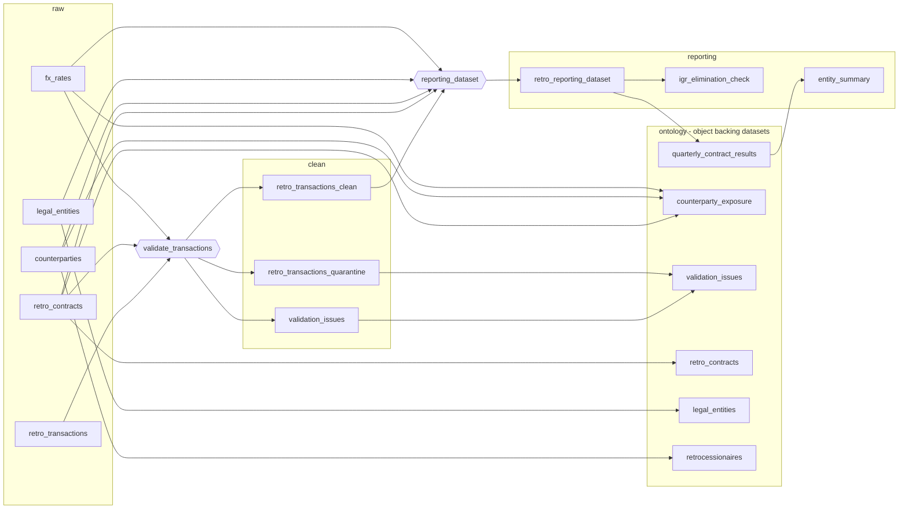

# Data lineage

| Dataset | Grain | Primary key | Produced by |
|---|---|---|---|
| retro_transactions_clean | one booking | txn_id | validate_transactions |
| retro_transactions_quarantine | one rejected booking | txn_id | validate_transactions |
| validation_issues | one rule failure | issue_id | validate_transactions |
| retro_reporting_dataset | one booking, in USD, enriched | txn_id | reporting_dataset |
| quarterly_contract_results | contract × quarter (ceded side) | result_id = contract_id\|period | quarterly_contract_results |
| entity_summary | entity × quarter × intra-group/external | – | entity_summary |
| counterparty_exposure | retrocessionaire at quarter end | retrocessionaire_id | counterparty_exposure |
| igr_elimination_check | quarter × line type | – | igr_elimination_check |

## Control points

1. **Row conservation**: clean + quarantine + removed duplicates = raw rows (tested).
2. **Tie-back**: ceded premium in the results equals the ceded premium bookings in the reporting
   dataset (tested to 5 cents).
3. **Result identity**: net result = paid + reserve change + commission − premium, per row (tested).
4. **Entity roll-up**: entity summary totals equal contract-level totals (tested).
5. **Elimination**: intra-group ceded and assumed amounts cancel per period and line type (tested).
6. **Determinism**: two runs with the same seed give identical results (tested).
